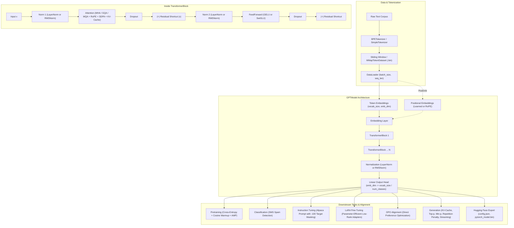

# Eru LLM Architecture Guide

## Component Overview

1. **`eru.tokenizer`**: Tokenization implementations:
   - `SimpleTokenizerV1`: Basic regex-based splitting.
   - `SimpleTokenizerV2`: Adds `<|unk|>` and `<|endoftext|>`.
   - `BPETokenizer`: Production Byte-Pair Encoding wrapping OpenAI `tiktoken`.
2. **`eru.model`**:
   - `GELU`: Gaussian Error Linear Unit activation with exact tanh approximation.
   - `LayerNorm`: Normalization over embedding dimension with learnable scale and shift.
   - `RMSNorm`: Root Mean Square Normalization omitting mean centering for modern speed and stability.
   - `RotaryEmbedding (RoPE)`: Rotary positional embeddings directly rotating Query and Key vectors in complex conjugate pairs.
   - `MultiHeadAttention`: Vectorized causal attention supporting:
     - Classic Multi-Head Attention (MHA).
     - Grouped-Query Attention (GQA) and Multi-Query Attention (MQA).
     - PyTorch Flash / Scaled Dot-Product Attention (`F.scaled_dot_product_attention`).
     - Key-Value Caching (`KVCache`) turning generation complexity from $O(T^2)$ to $O(T)$.
   - `FeedForward`: Position-wise MLP supporting standard GPT-2 GELU and modern LLaMA SwiGLU.
   - `TransformerBlock`: Pre-norm residual transformer layer.
   - `GPTModel`: Unified causal language model supporting classic GPT-2 and modern LLaMA architectures.
3. **`eru.data`**:
   - `GPTDatasetV1`: In-memory sliding-window causal chunking.
   - `MMapTokenDataset`: Zero-RAM memory-mapped binary dataset reading pre-tokenized `uint16` shards from disk for arbitrarily large corpora.
   - `InstructionDataset`: SFT dataset with dynamic batch padding and ignore-index target masking.
   - `SpamDataset`: SMS classification dataset loader.
4. **`eru.training`**:
   - `train_model_simple`: Pretraining loop with Automatic Mixed Precision (AMP), gradient norm clipping, and cosine learning rate scheduling with linear warmup.
   - `save_checkpoint` / `load_checkpoint`: State serialization.
5. **`eru.generation`**:
   - `generate`: Autoregressive generation with KV-cache, temperature scaling, top-$k$, nucleus top-$p$, min-$p$, and repetition penalties.
   - `generate_stream`: Real-time token streaming generator yielding tokens dynamically.
6. **`eru.finetune`**:
   - `classification`: Spam classifier with linear head adaptation, freezing base layers, and accuracy evaluation.
   - `instruction`: Supervised Fine-Tuning (SFT) engine with Alpaca formatting.
   - `lora`: Parameter-Efficient Fine-Tuning (PEFT) implementing low-rank $A$ and $B$ adapter matrices with runtime merging.
   - `dpo`: Direct Preference Optimization loss and preference dataset handler.
7. **`eru.weights`**:
   - `loader`: Pure PyTorch assignment of weights into `GPTModel`.
   - `tf_download`: Downloader for OpenAI TensorFlow v1 checkpoint files.
   - `hf_export`: Converter exporting Eru models directly into standard Hugging Face `transformers` checkpoints.
