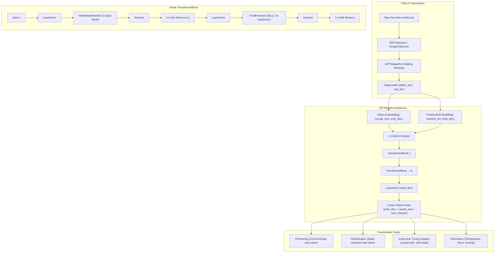

# Eru LLM Architecture Guide

## Component Overview

1. **`eru.tokenizer`**: Tokenization implementations:
   - `SimpleTokenizerV1`: Basic regex-based splitting.
   - `SimpleTokenizerV2`: Adds `<|unk|>` and `<|endoftext|>`.
   - `BPETokenizer`: Production Byte-Pair Encoding wrapping OpenAI `tiktoken`.
2. **`eru.model`**:
   - `GELU`: Gaussian Error Linear Unit activation with exact tanh approximation.
   - `LayerNorm`: Normalization over embedding dimension with trainable scale and shift.
   - `MultiHeadAttention`: Vectorized causal attention with upper-triangular masking and dropout.
   - `FeedForward`: Position-wise two-layer projection with $4\times$ inner expansion.
   - `TransformerBlock`: Pre-norm residual transformer layer.
   - `GPTModel`: Full generative pretrained transformer architecture.
3. **`eru.training`**:
   - `calc_loss_batch` / `calc_loss_loader`: Cross-entropy language modeling loss.
   - `train_model_simple`: Deterministic pretraining loop with progress tracking.
   - `save_checkpoint` / `load_checkpoint`: Model state serialization.
4. **`eru.finetune`**:
   - `classification`: Spam classifier with linear head adaptation, freezing base layers, and accuracy evaluation.
   - `instruction`: Supervised Fine-Tuning (SFT) with dynamic padding and $-100$ ignore-index collator.
5. **`eru.generation`**:
   - `generate`: Autoregressive generation supporting temperature scaling, top-$k$ truncation, and early termination.
   - `generate_greedy`: Fast argmax next-token prediction.
6. **`eru.weights`**:
   - `loader`: Pure PyTorch assignment of weights into GPTModel.
   - `tf_download`: Optional downloader for OpenAI TensorFlow v1 checkpoint files.
